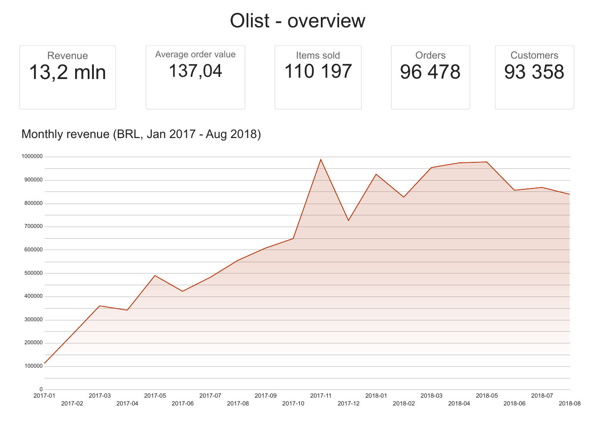
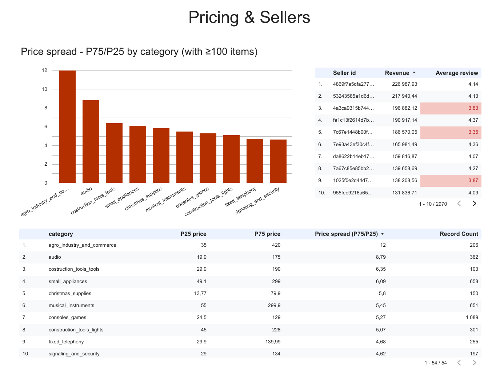
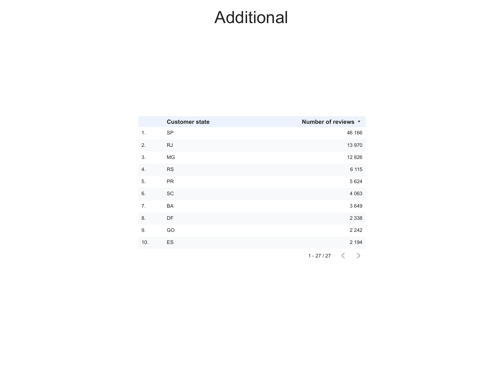

# Analysis of an E-commerce Marketplace Olist with BigQuery & Looker Studio

## Overview
This project analyses data of Brazilian E-Commerce website Olist using BigQuery and Looker Studio. The main goal of the analysis is to draw some insights from the Data and to create specific business recomendations depending on the outcome. The focus is put on understanding the market sells, prices across categories, sales across regions, delivery time, freight cost and customer satisfaction.

## Analysis (BigQuery & Looker Studio)
### Data Audit

This part of project is dedicated for the check of the quality of 9 tables that are included in the Dataset (from Kaggle). The process is conducted in BigQuery and is carried out to ensure the quality of the analysis. The full code is available in [`sql/01_data_audit.sql`](sql/01_data_audit.sql).

1. First the check of rows in every table, showed in one table:

```sql
SELECT 'orders' AS table_name, COUNT(*) AS row_count
FROM `olist-pricing-analysis.olist.orders`
UNION ALL
SELECT 'order items', COUNT(*)
FROM `olist-pricing-analysis.olist.order_items`
UNION ALL
SELECT 'products', COUNT(*)
FROM `olist-pricing-analysis.olist.products`
UNION ALL
SELECT 'customers', COUNT(*)
FROM `olist-pricing-analysis.olist.customers`
UNION ALL
SELECT 'sellers', COUNT(*)
FROM `olist-pricing-analysis.olist.sellers`
UNION ALL
SELECT 'order_payments', COUNT(*)
FROM `olist-pricing-analysis.olist.order_payments`
UNION ALL
SELECT 'order_reviews', COUNT(*)
FROM `olist-pricing-analysis.olist.order_reviews`
UNION ALL
SELECT 'category_translation', COUNT(*)
FROM `olist-pricing-analysis.olist.category_translation`
UNION ALL
SELECT 'geolocation', COUNT(*)
FROM `olist-pricing-analysis.olist.geolocation`;
```
2. Tables preview
```sql
SELECT * 
FROM `olist-pricing-analysis.olist.category_translation` 
LIMIT 10;

SELECT COUNT(*) AS total_rows 
FROM `olist-pricing-analysis.olist.category_translation`;

SELECT *
FROM `olist-pricing-analysis.olist.orders`
LIMIT 10;

SELECT *
FROM `olist-pricing-analysis.olist.order_items`
LIMIT 10;

SELECT *
FROM `olist-pricing-analysis.olist.products`
LIMIT 10;

SELECT *
FROM `olist-pricing-analysis.olist.category_translation`
LIMIT 10;
```
3. Check of distinct keys
   
The point is to check if total_rows = distinct_keys. If this is true then the key is unique and safe to join to the big table. When it comes to customers - customer_id is assigned per order so customer_unique_id identifies the real customer. Order_payments: one order can have several payment methods so order_id alone isn't unique. Order_id, payment_sequential is checked together to get the distinct keys. Order_reviews - an order can have more than one review. Geolocation will later be discarded (it won't be needed in the analysis).

```sql
SELECT 'orders' AS table_name, COUNT(*) AS row_count, COUNT(DISTINCT(order_id)) AS distinct_rows_count
FROM `olist-pricing-analysis.olist.orders`
UNION ALL
SELECT 'order_items (order_id + order_item_id)', COUNT(*),COUNT(DISTINCT CONCAT(order_id, '-', CAST(order_item_id AS STRING)))
FROM `olist-pricing-analysis.olist.order_items`
UNION ALL
SELECT 'products', COUNT(*), COUNT(DISTINCT(product_id))
FROM `olist-pricing-analysis.olist.products`
UNION ALL
SELECT 'customers', COUNT(*), COUNT(DISTINCT customer_unique_id)
FROM `olist-pricing-analysis.olist.customers`
UNION ALL
SELECT 'sellers', COUNT(*), COUNT(DISTINCT seller_id)
FROM `olist-pricing-analysis.olist.sellers`
UNION ALL
SELECT 'order_payments', COUNT(*),  COUNT(DISTINCT CONCAT(order_id, '-', CAST(payment_sequential AS STRING))) AS distinct_keys 
FROM `olist-pricing-analysis.olist.order_payments`
UNION ALL
SELECT 'order_reviews', COUNT(*), COUNT(DISTINCT order_id)
FROM `olist-pricing-analysis.olist.order_reviews`
UNION ALL
SELECT 'category_translation (product_category_name)',COUNT(*),COUNT(DISTINCT product_category_name)
FROM `olist-pricing-analysis.olist.category_translation`
UNION ALL
SELECT 'geolocation (zip code prefix)', COUNT(*),COUNT(DISTINCT geolocation_zip_code_prefix)
FROM `olist-pricing-analysis.olist.geolocation`;
```
4. Missing data in the key columns
```sql
SELECT 'orders' AS table_name, 'order_approved_at' AS column_name,COUNTIF(order_approved_at IS NULL) AS null_rows, COUNT(*) AS total_rows
FROM `olist-pricing-analysis.olist.orders`
UNION ALL
SELECT 'orders', 'order_delivered_customer_date',COUNTIF(order_delivered_customer_date IS NULL), COUNT(*)
FROM `olist-pricing-analysis.olist.orders`
UNION ALL
SELECT 'order_items', 'price', COUNTIF(price IS NULL), COUNT(*)
FROM `olist-pricing-analysis.olist.order_items`
UNION ALL
SELECT 'order_items', 'freight_value', COUNTIF(freight_value IS NULL), COUNT(*)
FROM `olist-pricing-analysis.olist.order_items`
UNION ALL
SELECT 'order_items', 'seller_id', COUNTIF(seller_id IS NULL), COUNT(*)
FROM `olist-pricing-analysis.olist.order_items`
UNION ALL
SELECT 'products', 'product_category_name',COUNTIF(product_category_name IS NULL OR product_category_name = ''), COUNT(*)
FROM `olist-pricing-analysis.olist.products`
UNION ALL
SELECT 'products', 'product_weight_g', COUNTIF(product_weight_g IS NULL), COUNT(*)
FROM `olist-pricing-analysis.olist.products`
UNION ALL
SELECT 'customers', 'customer_state', COUNTIF(customer_state IS NULL), COUNT(*)
FROM `olist-pricing-analysis.olist.customers`
UNION ALL
SELECT 'sellers', 'seller_state', COUNTIF(seller_state IS NULL), COUNT(*)
FROM `olist-pricing-analysis.olist.sellers`
UNION ALL
SELECT 'order_payments', 'payment_value', COUNTIF(payment_value IS NULL), COUNT(*)
FROM `olist-pricing-analysis.olist.order_payments`
UNION ALL
SELECT 'order_reviews', 'review_score', COUNTIF(review_score IS NULL), COUNT(*)
FROM `olist-pricing-analysis.olist.order_reviews`;
```


### Olist - overview

### Categories & prices

### Regional markets

### Delivery & satisfaction

### Pricing & sellers

### Additional


## Looker Studio Dashboard
Full Looker Studio Dashboard is available at the [Dashboard](dashboard)
## Data source
[Brazilian E-Commerce Public Dataset by Olist](https://www.kaggle.com/datasets/olistbr/brazilian-ecommerce)

## Tools
- BigQuery
- Looker studio

## Author
Bartosz Malinowski
