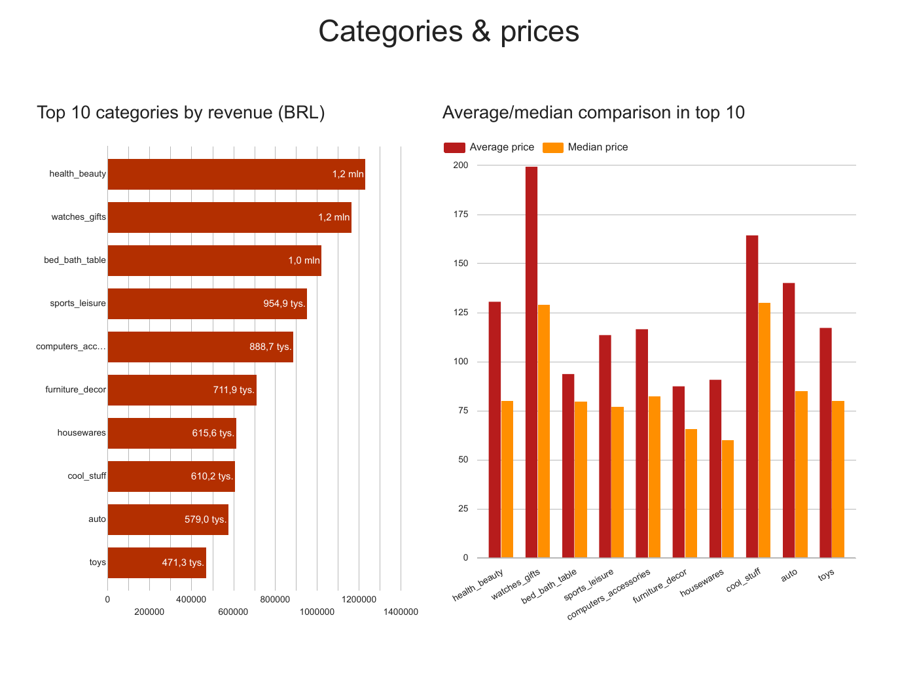
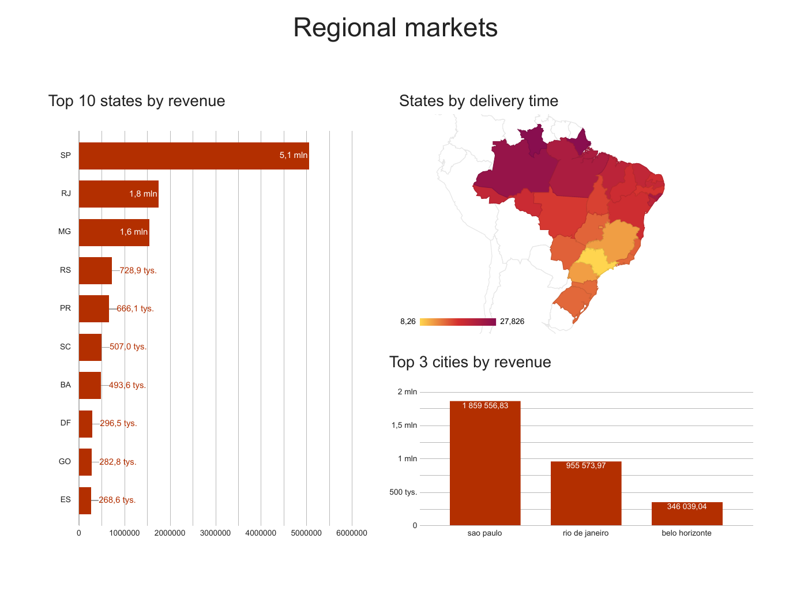

# Analysis of an E-commerce Marketplace Olist with BigQuery & Looker Studio

## Overview
This project analyses data of Brazilian E-Commerce website Olist using BigQuery and Looker Studio. The main goal of the analysis is to draw some insights from the Data and to create specific business recomendations depending on the outcome. The focus is put on understanding the market sells, prices across categories, sales across regions, delivery time, freight cost and customer satisfaction.

## Analysis (BigQuery & Looker Studio)
### Data Audit 
### Olist - overview

### Categories & prices

### Regional markets

### Delivery & satisfaction

### Pricing & sellers

### Additional

## Looker Studio Dashboard
Full Looker Studio Dashboard is available at the [Dashboard](dashboard)
## Data source
[Brazilian E-Commerce Public Dataset by Olist](https://www.kaggle.com/datasets/olistbr/brazilian-ecommerce)

## Tools
- BigQuery
- Looker studio

## Author
Bartosz Malinowski
