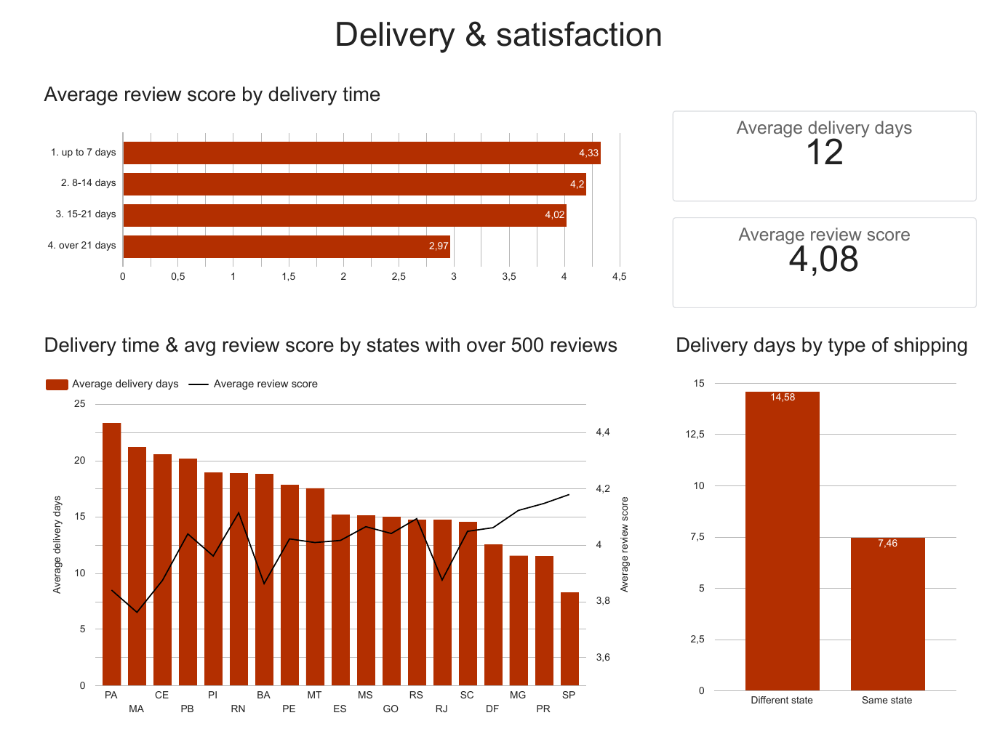

# Analysis of an E-commerce Marketplace Olist with BigQuery & Looker Studio

## Introduction
- This project analyses data of Brazilian E-Commerce website Olist using BigQuery and Looker Studio. The main goal of the analysis is to draw some insights from the Data and to create specific business recomendations depending on the outcome. The focus is put on understanding the market sells, prices (across categories), sales (across regions), delivery time, freight cost and customer satisfaction.

## Table of contents

- [Analysis (BigQuery & Looker Studio)](#analysis-bigquery--looker-studio)
  - [1. Data Check](#1-data-check)
  - [2. Cleaning](#2-cleaning)
  - [3. Overview](#3-overview)
  - [4. Categories & prices](#4-categories--prices)
  - [5. Regional markets](#5-regional-markets)
  - [6. Delivery & satisfaction](#6-delivery--satisfaction)
- [Conclusions](#conclusions)
- [Recommendations](#recommendations)
- [Data source & Full Dashboard](#data-source--full-dashboard)
- [Tools](#tools)
- [Author](#author)
  
## Analysis (BigQuery & Looker Studio)

### 1. Data Check

- This part of project is dedicated for the check of the quality of 9 tables that are included in the Dataset (from Kaggle).
- The process is conducted in BigQuery and is carried out to ensure the quality of the analysis.
- The full code is available in [`sql/01_data_check.sql`](sql/01_data_check.sql).

#### 1. Row counts - to get to know the data and see with how big dataset will I be working with. All CSV tables were loaded correctly. 

  
| table_name           | row_count |
|----------------------|----------:|
| orders               |    99,441 |
| order_items          |   112,650 |
| products             |    32,951 |
| customers            |    99,441 |
| sellers              |     3,095 |
| order_payments       |   103,886 |
| order_reviews        |    99,224 |
| category_translation |        71 |
| geolocation          | 1,000,163 |

- Order_items may have a bit more rows than order_items - it may be because one order may contain multiple items.
- We are starting with almost a 100k orders, 33k products, over 3k sellers.
- The thing that should get attention is that orders and customers are the same number. It will have to be checked later.

#### 2. Tables preview - to see the column names and example data across different tables. The example query outcome is showed below.

| product_category_name | product_category_name_english |
|:---|:---|
| alimentos_bebidas | food_drink |
| malas_acessorios | luggage_accessories |
| beleza_saude | health_beauty |
| fashion_bolsas_e_acessorios | fashion_bags_accessories |
| alimentos | food |
| fashion_underwear_e_moda_praia | fashion_underwear_beach |
| audio | audio |
| portateis_casa_forno_e_cafe | small_appliances_home_oven_and_coffee |
| construcao_ferramentas_seguranca | construction_tools_safety |
| eletrodomesticos | home_appliances |

#### 3. Check of distinct keys - to see if the keys are unique so joining the tables would be safe and not duplicate the rows.

| table_name | row_count | distinct_rows_count |
|:---|---:|---:|
| orders | 99441 | 99441 |
| order_items (order_id + order_item_id) | 112650 | 112650 |
| products | 32951 | 32951 |
| customers | 99441 | 96096 |
| sellers | 3095 | 3095 |
| order_payments | 103886 | 103886 |
| order_reviews | 99224 | 98673 |
| category_translation (product_category_name) | 71 | 71 |
| geolocation (zip code prefix) | 1000163 | 19015 |

- Key are unique in: orders, products, sellers, category_translation.
- For order_items and order_payments it was needed to create a distinct key with forcing together order_id + order_item_id for order_items and order_id + payment_sequential for order_payments. Thanks to that - they can be joined safely.
- Customers has 99441 rows but only 96096 distinct customer_unique_id values (customer_id may be assigned per order). Customers will be counted with customer_unique_id.
- Order_reviews will be changed later to create a possibility of joining them with the rest of the data.
- Geolocation will not be joined to the other tables. 

#### 4. Missing data in the most important columns - missing values decide which rows can be used - we can't calculate the average delivery date for rows without delivery time.

| table_name | column_name | null_rows | total_rows |
|:---|:---|---:|---:|
| orders | order_approved_at | 160 | 99441 |
| orders | order_delivered_customer_date | 2965 | 99441 |
| order_items | price | 0 | 112650 |
| order_items | freight_value | 0 | 112650 |
| order_items | seller_id | 0 | 112650 |
| products | product_category_name | 610 | 32951 |
| products | product_weight_g | 2 | 32951 |
| customers | customer_state | 0 | 99441 |
| sellers | seller_state | 0 | 3095 |
| order_payments | payment_value | 0 | 103886 |
| order_reviews | review_score | 0 | 99224 |

- Columns containing NULLs - order_approved_at (orders), order_delivered_customer_date (orders), product_category_name (products), product_weight_g (products).
- The column with time of approval won't be used.
- For the calculation of metrics with delivery date, metrics will use only the delivered ones, 610 products have no category so they will be marked as "unknown" so we don't loose the data.
- 2 products have no weight but it won't be needed for the analysis.

#### 5. Check of order statuses and their share in the data + date range - to check how many orders we're delivered (and their other statuses). Also to check what is the timestamp.
   

| order_status | how_many_orders | percent |
|:---|---:|---:|
| delivered | 96478 | 97.02 |
| shipped | 1107 | 1.11 |
| canceled | 625 | 0.63 |
| unavailable | 609 | 0.61 |
| invoiced | 314 | 0.32 |
| processing | 301 | 0.3 |
| created | 5 | 0.01 |
| approved | 2 | 0.0 |

- Delivered orders have 97% of the whole deliveries, shipped have 1% (probably still in transit) and canceled have only 0,63% of the orders.

| first_order | last_order |
|:---:|:---:|
| 2016-09-04 21:15:19 UTC | 2018-10-17 17:30:18 UTC |

- The first order was issued on 4th of September 2016, and the last one on 17th of October 2018.
- The timestamp is more than 2 years.

#### 6. Price and freight check (min/max, average, median, zero values) - to see the range of prices and freight costs and to spot extreme or zero values before calculating averages and medians.

| items | min_price | max_price | avg_price | median_price | p99_price | min_freight | max_freight | avg_freight | zero_freight |
|---:|---:|---:|---:|---:|---:|---:|---:|---:|---:|
| 112650 | 0.85 | 6735.0 | 120.65 | 74.99 | 890.0 | 0.0 | 409.68 | 19.99 | 383 |

- Item prices vary from 0.85 BRL to 6735 BRL.
- Average price is 120.65, median is 74.99 (Median is smaller than the average so it implies right-skeweness of the distribution - most of the products have smaller prices but some of them have much higher and that's why mean chases the tail and ends up higher than the median).
- The freight varies from 0 to 409.68 BRL and it's average is 20 BRL.
- Amount of orders with zero freight - 383.

#### 7. Check if the dates are consistent and if there are any errors (orders without a date or delivered before they were purchased)

| delivered_without_date | delivered_before_purchase |
|:---:|:---:|
| 8 | 0 |

- Eight of the orders were delivered without a delivery date and 0 were delivered before purchase - everything works.

### 2. Cleaning

- The raw data is spread across 9 tables. To avoid repeating the same joins in every query, one base view called big_table was created. It contains everything needed for the analysis, with one row per delivered order item.

#### 1. Reviews made to be one row per order**

- The data check in 1.3 showed that some of the orders have more than one review.
- Joining reviews directly to order items would duplicate those items and inflate revenue and item counts. A view reviews_per_order was created with the average score per order. After this every order has at maximum one review - it can be joined safely now.

#### 2. Creation of one big table containing everything necessary for the analysis (big_table)**

- A single table will be used for all the analysis queries.
- It is built step by step by joining: order_items + orders (purchase dates and delivery dates) + customers (customer_unique_id, customer state and city) + sellers (seller state and city) + reviews_per_order + products + category_translation (review score and product category).
- For the first join (items and orders) INNER JOIN was used to get only these rows that occur in both of the tables.
- For the rest (after having items and their orders) we join the rest with LEFT JOIN, so that we have everything that is in the base table and only those rows that are shared in this and the other tables.

   

| order_id | order_item_id | product_id | seller_id | price | freight_value | customer_id | purchase_date | purchase_month | delivery_days | freight_share_of_price | customer_unique_id | customer_state | customer_city | seller_state | seller_city | review_score | portuguese_category | category |
|:---|---:|:---|:---|---:|---:|:---|:---|:---|---:|---:|:---|:---|:---|:---|:---|---:|:---|:---|
| 3ee6513ae7ea23bdfab5b9ab60bffcb5 | 1 | 8a3254bee785a526d548a81a9bc3c9be | 96804ea39d96eb908e7c3afdb671bb9e | 0.85 | 18.23 | 161b6d415e8b3413c6609c70cf405b5a | 2018-04-24 | 2018-04-01 | 13 | 21.447 | d80730c15c647bc8f2ad77c908ba5ca9 | SP | hortolandia | MG | ibia | 4.0 | construcao_ferramentas_construcao | construction_tools_construction |
| 6e864b3f0ec71031117ad4cf46b7f2a1 | 1 | 8a3254bee785a526d548a81a9bc3c9be | 96804ea39d96eb908e7c3afdb671bb9e | 0.85 | 18.23 | 9f9d249355f63c5c1216a82b802452c1 | 2018-04-24 | 2018-04-01 | 9 | 21.447 | b38211bd797f4fdd81a98b9d1754b606 | RJ | duque de caxias | MG | ibia | 5.0 | construcao_ferramentas_construcao | construction_tools_construction |
| c5bdd8ef3c0ec420232e668302179113 | 2 | 8a3254bee785a526d548a81a9bc3c9be | 96804ea39d96eb908e7c3afdb671bb9e | 0.85 | 22.3 | 5af78bf1a82a2660d1e3fd78c645f58f | 2018-04-27 | 2018-04-01 | 8 | 26.235 | f006d7920bd71c252f61ec355eb50dcb | SP | cotia | MG | ibia | 1.0 | construcao_ferramentas_construcao | construction_tools_construction |

- And the big_table is created.

#### 3. Validation (check if big_table was created properly, if any data was lost and no rows are duplicated)

| check_name | value |
|:---|---:|
| Missing customer city | 0 |
| Distinct keys in the big table (order_id + order_item_id) | 110197 |
| Missing delivery days | 8 |
| Missing review score | 827 |
| Category = unknown | 1537 |
| Missing seller city | 0 |
| Missing seller state | 0 |
| Expected rows (delivered) | 110197 |
| Missing customer state | 0 |
| How many rows | 110197 |

- Table big_table has 110197 rows like it supposed to and every item key (order_id + order_item_id) is unique. 

#### 4. Summary (missing values in big_table)

- Eight items have no delivery_days.
- The average and median ignore NULL so we leave them as they are. Filling in 0 would artificially lower the average delivery days. 827 items have no review score - no review doesn't mean a score of 0 so nothing is filled in.
- 1537 items are with a category 'unknown'. They are left here so the total analysis stays complete.

### 3. Overview

- This stage describes the scale of the marketplace and sets reference values for all later analyses.
- All KPIs are calculated from big_table, so they cover delivered order items only.

#### 1. Overall KPIs - to find out basic business numbers as items sold, revenue, orders, sellers, customers, freight etc.

- Revenue is calculated as sum of price, average order value is revenue divided by the number of distinct orders (one order can have multiple items so it has to be the amount of orders), customers are counted with customer_unique_id, median and 99th percentile are added because some of the items may pull the mean up. 

| items_sold | orders | products | sellers | customers | revenue | mln_revenue | total_freight | average_order_value | avg_price | median_item_price | ninetynine_percentil_price | average_delivery_days | average_review_score |
|---:|---:|---:|---:|---:|---:|---:|---:|---:|---:|---:|---:|---:|---:|
| 110197 | 96478 | 32216 | 2970 | 93358 | 13221498.11 | 13.221 | 2198275.64 | 137.04 | 119.98 | 74.9 | 888.9 | 12.0 | 4.08 |

- The delivered orders contain 110197 items delivered in 96478 orders, sold by 2970 sellers across 32216 products - sold to 93358 customers.
- Revenue is 13.22 milion BRL and the freight is 2.19 mln BRL.
- The average order value is 137.04 BRL, an average product price is 119.98.
- Orders are delivered on average in 12 days and the average review score is 4.08/5.

#### 2. Monthly trend - to see how sales changed over time, find peak and lowest months, and check whether the peaks were caused by bigger sales or bigger basket (more items).

- The first 3 months are to sparse for analysis so they won't be taken into account.

| purchase_month | items_sold | revenue | average_order_value |
|:---|---:|---:|---:|
| 2016-09-01 | 3 | 134.97 | 134.97 |
| 2016-10-01 | 313 | 40325.11 | 152.17 |
| 2016-12-01 | 1 | 10.9 | 10.9 |
| 2017-01-01 | 913 | 111798.36 | 149.06 |
| 2017-02-01 | 1858 | 234223.4 | 141.7 |
| 2017-03-01 | 2897 | 359198.85 | 141.08 |
| 2017-04-01 | 2569 | 340669.68 | 147.92 |
| 2017-05-01 | 4004 | 489338.25 | 138.0 |
| 2017-06-01 | 3489 | 421923.37 | 134.58 |
| 2017-07-01 | 4416 | 481604.52 | 124.38 |
| 2017-08-01 | 4797 | 554699.7 | 132.29 |
| 2017-09-01 | 4737 | 607399.67 | 146.36 |
| 2017-10-01 | 5214 | 648247.65 | 144.76 |
| 2017-11-01 | 8475 | 987765.37 | 135.51 |
| 2017-12-01 | 6187 | 726033.19 | 131.69 |
| 2018-01-01 | 8037 | 924645.0 | 130.8 |
| 2018-02-01 | 7518 | 826437.13 | 126.08 |
| 2018-03-01 | 8017 | 953356.25 | 136.14 |
| 2018-04-01 | 7827 | 973534.09 | 143.21 |
| 2018-05-01 | 7810 | 977544.69 | 144.84 |
| 2018-06-01 | 7010 | 856077.86 | 140.36 |
| 2018-07-01 | 6963 | 867953.46 | 140.92 |
| 2018-08-01 | 7142 | 838576.64 | 132.04 |

- Sales grew from 913 items (111,798.36 BRL revenue) in January 2017 to it's peak of 8475 (987765.37 BRL revenue) in November 2017.
- The average order value was oscillating around the mean (137,04 BRL) and the revenue grew bigger. This means that sales grew because customers placed more orders, not because their baskets were more expensive.

#### 3. Top 10 categories - to find which product categories bring the most revenue, how many items they sold, their average price and median.

| category | revenue | items_sold | average_price | median_price |
|:---|---:|---:|---:|---:|
| health_beauty | 1233131.72 | 9465 | 130.28 | 79.9 |
| watches_gifts | 1166176.98 | 5859 | 199.04 | 128.9 |
| bed_bath_table | 1023434.76 | 10953 | 93.44 | 79.57 |
| sports_leisure | 954852.55 | 8431 | 113.25 | 76.9 |
| computers_accessories | 888724.61 | 7644 | 116.26 | 81.99 |
| furniture_decor | 711927.69 | 8160 | 87.25 | 65.49 |
| housewares | 615628.69 | 6795 | 90.6 | 59.7 |
| cool_stuff | 610204.1 | 3718 | 164.12 | 129.9 |
| auto | 578966.65 | 4140 | 139.85 | 84.9 |
| toys | 471286.48 | 4030 | 116.94 | 79.9 |

- The category with highest revenue is health_beauty 1233131.72 BRL and 9465 items.
- Watches & gifts has the second highest revenue with much less items sold. That is because their average price is very high.
- In every top 10 category the average price is higher than the median price.

### 4. Categories & prices
#### 1. Prices in categories (25th percentile, median, 75th percentile)

- The 25th and 75th percentiles are added (the middle 50% of prices lies between them) which show the typical price range of a category.
- Only categories with at least 100 items sold are included, for the medians to be reliable.

| category | items_sold | price_p25 | median_price | price_p75 |
|:---|---:|---:|---:|---:|
| computers | 199 | 650.0 | 1100.0 | 1340.0 |
| agro_industry_and_commerce | 206 | 35.0 | 229.0 | 420.0 |
| home_appliances_2 | 231 | 154.0 | 227.99 | 559.0 |
| furniture_bedroom | 103 | 95.0 | 179.0 | 219.0 |
| office_furniture | 1668 | 114.99 | 144.94 | 186.99 |
| air_conditioning | 289 | 75.9 | 139.99 | 199.0 |
| cool_stuff | 3718 | 69.9 | 129.9 | 199.0 |
| watches_gifts | 5859 | 59.0 | 128.9 | 209.9 |
| construction_tools_safety | 183 | 65.0 | 115.0 | 285.0 |
| kitchen_dining_laundry_garden_furniture | 274 | 54.9 | 109.0 | 209.9 |

#### 2. Price dispersion within categories

- Two categories can have a similar median price but a very different spread of prices.
- The ratio of the 75th to the 25th percentile shows how wide the range of typical prices is.
- A ratio close to 1 means similar prices, and a high ratio means the category mixes cheap and expensive items.

| category | items_sold | price_p25 | median_price | price_p75 | p75_p25_ratio |
|:---|---:|---:|---:|---:|---:|
| agro_industry_and_commerce | 206 | 35.0 | 229.0 | 420.0 | 12.0 |
| audio | 362 | 19.9 | 89.0 | 175.0 | 8.79 |
| costruction_tools_tools | 103 | 29.9 | 59.99 | 190.0 | 6.35 |
| small_appliances | 658 | 49.1 | 98.0 | 299.0 | 6.09 |
| christmas_supplies | 150 | 13.77 | 45.8 | 79.9 | 5.8 |
| musical_instruments | 651 | 55.0 | 94.9 | 299.9 | 5.45 |
| consoles_games | 1089 | 24.5 | 54.89 | 129.0 | 5.27 |
| construction_tools_lights | 301 | 45.0 | 100.0 | 228.0 | 5.07 |
| fixed_telephony | 255 | 29.9 | 49.0 | 139.99 | 4.68 |
| signaling_and_security | 197 | 29.0 | 75.0 | 134.0 | 4.62 |

- The widest price dispersion is in agro_industry_and_commerce and it's 12. That means that the 75th percentile is 12 times bigger than the 25th percentile (420 to 35). This category is followed by audio, costruction_tools_tools, small_appliances.
- The smallest dispersion is in industry_commerce_and_business - 1.51 and fashion_underwear_beach 1.6. A high ratio can also mean that a category contains different types of products

#### 3. Items with the highest price compared with the median price of the same product

| seller_id | product_id | category | price | median_product_price | price_index |
|:---|:---|:---|---:|---:|---:|
| 620c87c171fb2a6dd6e8bb4dec959fc6 | 6ae7f4ef0ca670ca2609d039af87d057 | perfumery | 99.0 | 23.9 | 4.14 |
| 7299e27ed73d2ad986de7f7c77d919fa | f03859e4cc21018569f5ae7a03897ff4 | consoles_games | 159.99 | 49.99 | 3.2 |
| ef506c96320abeedfb894c34db06f478 | a0fe1efb855f3e786f0650268cd77f44 | agro_industry_and_commerce | 59.99 | 21.99 | 2.73 |
| ef506c96320abeedfb894c34db06f478 | a0fe1efb855f3e786f0650268cd77f44 | agro_industry_and_commerce | 59.99 | 21.99 | 2.73 |
| ef506c96320abeedfb894c34db06f478 | a0fe1efb855f3e786f0650268cd77f44 | agro_industry_and_commerce | 59.99 | 21.99 | 2.73 |
| beadbee30901a7f61d031b6b686095ad | 2fea0f2cec6b6324a277d4a61c2ed2c6 | health_beauty | 95.0 | 35.0 | 2.71 |
| beadbee30901a7f61d031b6b686095ad | 2fea0f2cec6b6324a277d4a61c2ed2c6 | health_beauty | 95.0 | 35.0 | 2.71 |
| beadbee30901a7f61d031b6b686095ad | 2fea0f2cec6b6324a277d4a61c2ed2c6 | health_beauty | 95.0 | 35.0 | 2.71 |
| f27e33c6d29b5138fa9967bcd445b6d5 | 7ac0d3f8ac5b60c13d74b02b8cbb4623 | pet_shop | 239.9 | 94.9 | 2.53 |
| 6edacfd9f9074789dad6d62ba7950b9c | 081476f0ad46b45e23bbd0f3d1d4dd98 | housewares | 49.9 | 19.9 | 2.51 |

- The highest above the median (market price) is an item sold in perfumery - sold for 99 BRL while the median is 23.9 BRL
- The lowest below the median is a product sold in audio with only 0.1 price index (which indicates that the product is sold way below the market price).

### 5. Regional markets
#### 1. Metrics by customer state

- To compare the regional markets of Brazil.
- For each customer state, the query shows revenue, average item price, average freight, average delivery time and average review score. This shows where sales are concentrated and where customers pay more for shipping, wait longer and rate their orders lower.

| customer_state | revenue | average_price | average_freight | average_delivery_days | average_review_score |
|:---|---:|---:|---:|---:|---:|
| SP | 5067633.16 | 109.1 | 15.12 | 8.26 | 4.18 |
| RJ | 1759651.13 | 124.42 | 20.91 | 14.69 | 3.87 |
| MG | 1552481.83 | 120.2 | 20.63 | 11.51 | 4.12 |
| RS | 728897.47 | 118.83 | 21.61 | 14.71 | 4.09 |
| PR | 666063.51 | 117.91 | 20.47 | 11.48 | 4.15 |
| SC | 507012.13 | 123.75 | 21.51 | 14.52 | 4.05 |
| BA | 493584.14 | 134.02 | 26.49 | 18.77 | 3.86 |
| DF | 296498.41 | 125.9 | 21.07 | 12.5 | 4.06 |
| GO | 282836.7 | 124.21 | 22.56 | 14.95 | 4.04 |
| ES | 268643.45 | 120.74 | 22.03 | 15.19 | 4.01 |

- SP has by far the highest revenue 5067633 BRL, followed by RJ (1759651 BRL) and MG (1552481 BRL).
- The lowest revenue is in RR with only 7057 BRL.
- SP has also the lowest average delivery time (8 days), the lowest average freight - 15 BRL and the lowest average price.
- Lowest reviews are in MA, PA, and BA. The highest is in AP.

#### 2. Metrics by customer city
- A state can include both a large city and small towns, so the same metrics are calculated for the 20 cities with the highest revenue.

| customer_city | customer_state | revenue | average_price | average_freight | average_delivery_days | average_review_score |
|:---|:---|---:|---:|---:|---:|---:|
| sao paulo | SP | 1859556.83 | 106.87 | 14.28 | 7.56 | 4.17 |
| rio de janeiro | RJ | 955573.97 | 125.87 | 20.57 | 14.2 | 3.91 |
| belo horizonte | MG | 346039.04 | 112.1 | 19.41 | 10.64 | 4.09 |
| brasilia | DF | 295814.72 | 126.36 | 21.1 | 12.51 | 4.06 |
| curitiba | PR | 205999.33 | 119.28 | 18.8 | 9.93 | 4.13 |
| campinas | SP | 184657.87 | 113.57 | 14.97 | 9.23 | 4.09 |
| porto alegre | RS | 182319.55 | 115.91 | 20.65 | 15.44 | 3.97 |
| salvador | BA | 173273.05 | 127.59 | 25.36 | 18.68 | 3.74 |
| guarulhos | SP | 139008.19 | 107.43 | 14.47 | 7.6 | 4.13 |
| niteroi | RJ | 115890.26 | 120.97 | 20.42 | 13.76 | 3.92 |

- The highest revenue city is Sao Paulo with 1859556 BRL revenue. It's followed by Rio de Janeiro and Belo horizonte.
- Among the top 10 cities, the three from SP (sao paulo, campinas, guarulhos) have the shortest delivery times (7.56, 9.23 and 7.60 days) and the lowest average freight (14.28, 14.97 and 14.47 BRL).

#### 3. Most popular category in each top 10 state.

- Ordered by items sold.

| customer_state | category | items_sold |
|:---|:---|---:|
| SP | bed_bath_table | 5157 |
| RJ | bed_bath_table | 1605 |
| MG | bed_bath_table | 1322 |
| RS | bed_bath_table | 611 |
| PR | furniture_decor | 516 |
| SC | sports_leisure | 356 |
| BA | health_beauty | 340 |
| DF | health_beauty | 242 |
| PE | health_beauty | 233 |
| GO | bed_bath_table | 231 |

- Bed_bath_table is the most popular category in 5 of the 10 states shown (SP, RJ, MG, RS, GO).
- Health_beauty is the most popular category in 3 states (BA, DF, PE).

#### 4. Most popular category in each top 10 cities.

- Ordered by items sold.

| customer_city | category | items_sold |
|:---|:---|---:|
| sao paulo | bed_bath_table | 1950 |
| rio de janeiro | bed_bath_table | 829 |
| belo horizonte | bed_bath_table | 348 |
| brasilia | health_beauty | 242 |
| porto alegre | bed_bath_table | 174 |
| campinas | bed_bath_table | 165 |
| curitiba | furniture_decor | 151 |
| salvador | health_beauty | 135 |
| guarulhos | bed_bath_table | 133 |
| niteroi | bed_bath_table | 104 |

- Bed_bath_table is the most popular category in 7 of the 10 cities shown (sao paulo, rio de janeiro, belo horizonte, porto alegre, campinas, guarulhos, niteroi).
- Health_beauty leads in brasilia (242 items) and salvador (135 items), and furniture_decor leads in curitiba (151 items).

### 6. Delivery & satisfaction
- To check whether customers give lower ratings when they wait longer for delivery.
- Items are put into four delivery time groups with CASE WHEN, and the average review score is compared between the groups.

#### 1. Delivery time and review score

| delivery_days_group | items_sold | average_review_score |
|:---|---:|---:|
| 1) Up to 7 days | 38720 | 4.33 |
| 2) 8 to 14 days | 41716 | 4.2 |
| 3) 15 to 21 days | 17479 | 4.02 |
| Over 21 days | 12274 | 2.97 |

- Items delivered up to 7 days have an average review score of 4.33/5. The score falls with each group.
- The last one over 21 days has an average score of 2.97/5.
- There may be a correlation between the review score and delivery time (the review score may decrease with the inscrease in delivery time).
#### 2. Top 10 sellers by revenue
- To see how revenue is spread across the biggest sellers and whether the sellers with the highest sales also have good review scores.

| seller_id | revenue | avg_review_score |
|:---|---:|---:|
| 4869f7a5dfa277a7dca6462dcf3b52b2 | 226987.93 | 4.14 |
| 53243585a1d6dc2643021fd1853d8905 | 217940.44 | 4.13 |
| 4a3ca9315b744ce9f8e9374361493884 | 196882.12 | 3.83 |
| fa1c13f2614d7b5c4749cbc52fecda94 | 190917.14 | 4.37 |
| 7c67e1448b00f6e969d365cea6b010ab | 186570.05 | 3.35 |
| 7e93a43ef30c4f03f38b393420bc753a | 165981.49 | 4.36 |
| da8622b14eb17ae2831f4ac5b9dab84a | 159816.87 | 4.07 |
| 7a67c85e85bb2ce8582c35f2203ad736 | 139658.69 | 4.27 |
| 1025f0e2d44d7041d6cf58b6550e0bfa | 138208.56 | 3.87 |
| 955fee9216a65b617aa5c0531780ce60 | 131836.71 | 4.09 |

- Top seller made 226987 BRL in revenue and has the review of avg 4.14/5.
- The 5th best seller made 186570 BRL in revenue but has a much lower score than average which is 3.35/5.

#### 3. Same-state vs cross-state shipping
- To check whether shipping within the same state is faster and cheaper than shipping between states.
- Each item is labelled "same state" when the seller and the customer are in the same state, and "different state" otherwise.

| shipping_type | avg_delivery_days | avg_freight_value |
|:---|---:|---:|
| different state | 14.58 | 24.0 |
| same state | 7.46 | 13.0 |

- Items delivered across different states have higher average delivery time (14.58) than ones that are delivered in the same state (7.46).
- Average freight is more expensive in cross-state deliveries (24 BRL) than in the same state (13 BRL). 

## Conclusions

  

 - Olist - Brazilian Marketplace platform through years 2016 - 2018 created over 13.2 mln BRL of revenue. The first sold order was on 2016-09-04 and the last one counted in the analysis was on 2018-10-17. That is over 2 years of timpespan. Through that years Olist sold and delivered 110,197 items in 96478 orders, sold by 2970 sellers across 32216 products - sold to 93358 customers. 
- The analysis contained dates from 2017 - the first 3 months were too sparse for the analysis (in the first 3 months Olist sold only 3, 313 and 1 item).
- Sales grew from 913 items (111,798.36 BRL revenue) in January 2017 to it's peak of 8475 (987765.37 BRL revenue) in November 2017 which could potentially have been driven by Black Friday.
- The average order value was oscillating around the mean (137,04 BRL) and the revenue grew bigger. This means that sales grew because customers placed more orders, not because their baskets were more expensive.

  

- Category with the highest revenue was health_beauty with over 1.22 mln BRL and 9465 items sold, followed by watches_gifts with almost 1.22 mln BRL in revenue and 5859 items sold. Watches and gifts category has  much smaller number of items sold than other top 7 categories and a second best score in revenue. This phenomenom could occur due to very high average price of 199.04 BRL and high median of 128.9 BRL.
- In every top 10 category the average price is higher than the median price. Which indicates a right-skewed distribution (mean follows few expensive items and most of the items are around the median).

  

- The 25th and 75th percentiles were added (the middle 50% of prices lies between them) which show the typical price range of a category. And only categories with at least 100 items sold are included, for the medians to be reliable.
- The ratio of the 75th to the 25th percentile shows how wide the range of typical prices is. A higher number indicates more vary range of prices in a category.
- The widest dispersion is in the category agro_industry_and_commerce and it's 12. That means that the 75th percentile is 12 times bigger than the 25th percentile (420 to 35). This category is followed by audio, costruction_tools_tools, small_appliances.
- The smallest dispersion is in industry_commerce_and_business - 1.51 and fashion_underwear_beach 1.6.
- A high ratio can also mean that a category contains different types of products
- When it comes to top sellers - the first one made almost 227k of revenue and had an average review score of 4.14. Three out of top 10 sellers had their review score below 4.

  

- SP state had the highest revenue of 5.1 mln BRL, followed by RJ - 1.8 mln and MG 1.6 mln BRL. SP has also the lowest average delivery time (8 days), the lowest average freight - 15 BRL and the lowest average price.
- The lowest revenue state was RR with only 7057 BRL.
- The highest revenue city is Sao Paulo with 1.9 mln BRL revenue. It's followed by Rio de Janeiro (1 mln BRL) and Belo horizonte (346k).
- It is easy to see that the states in the North have much higher delivery time than the ones beside Sao Paolo. It looks like there could be a correlation - with the increase in the distance from Sao Paolo the average delivery days rise.
- Bed_bath_table is the most popular category in 5 of the top 10 states (in SP on the top as well)
- Bed_bath_table is the most popular category in 7 of the top 10 cities.

  

- Items delivered up to 7 days have an average review score of 4.33/5. The score falls with each group. The last one over 21 days has an average score of 2.97/5. There may be a correlation between the review score and delivery time (the review score may decrease with the inscrease in delivery time).
- When it comes to deliveries within the same state and the cross-shipped - the second ones have much bigger average delivery time - almost 15 days and the ones within the same state have only 7.46.
- The freight for both of these types of delivery cost accordingly 24 BRL - for cross-shipped and 13 BRL for the one shipped within the same state.
- The average delivery takes about 12 days and gets a review on average of 4,08/5.

## Recommendations
1. **Try to keep the delivery time as low as it's doable (possibly below 21 days)** - items in the group of delivered in more than 21 days got an average review of 2.97/5 and the ones delivered up to 7 days - 4.33/5. Olist should track the potential delay of the orders and act early by contacting the seller and the customer (so the review stays high).
2.  **Grow seller base outside of Sao Paolo state (Up in the North states).** Same state shipping is much cheaper for the customer - 13 BRL and could potentially bring faster deliveries (avg 7.46 days) and better reviews. Cross shipping is much more expensive - 24 BRL and takes longer time - 14.58 days on average. Recruiting new sellers in the North would bring value not only to the business but also to the customers and sellers.
3.  **Monitor top sellers reviews** - three of the top 10 sellers (in revenue) got a review below 4 (even 3.35). That could potentially be the reason for long average deliveries. Better reviewed sellers should be more supported.
4.  **Pioritize most popular categories** - health_beauty brings the highest revenue (1.2 mln BRL) and bed_bath_table is the most popular category in 7 of the top 10 cities.
5. **Monitor items sold way above or below the market price (median of the market)** - One product sold in perfumery is sold for 99 BRL while the median is 23.9 BRL) that could indicate that product is sold for 4 times as the market price is (potentially).

## Data source & Full Dashboard
[Brazilian E-Commerce Public Dataset by Olist](https://www.kaggle.com/datasets/olistbr/brazilian-ecommerce)

Full Looker Studio Dashboard is available at the [Dashboard](dashboard)

## Tools
- BigQuery
- Looker studio

## Author
Bartosz Malinowski
